  

  
  

## SIMA nedir?

Türkçe toplantıları **canlı** dinleyip transkripte döken, ardından özet ve aksiyon maddelerini çıkaran bir asistan.
Kendi başıma kuruyorum: ürün, site, otomasyonlar.

| Katman | Ne yapıyor |
|---|---|
| **Ürün** | Canlı Türkçe transkript + özet |
| **Site** | [hellosima.com](https://hellosima.com) |
| **Otomasyon** | Müşteri kazanım ve operasyon akışları |

  <a href="https://hellosima.com"><b>Demoyu görmek için → hellosima.com</b></a>

